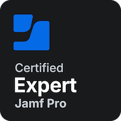
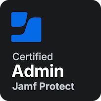
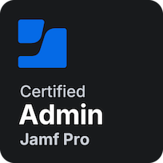
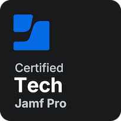
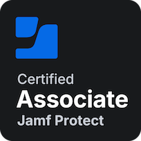
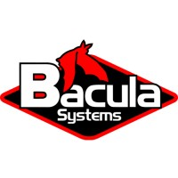

Hey, I'm Matt.

I'm passionate about building internal platforms and automation for storage systems and endpoint management, with a particular focus on Apple platforms, Infrastructure as Code and GitOps.

My work centres around Go, Swift, Salt and Terraform, building tools that make managing devices and infrastructure simpler, more repeatable and easier to operate. I enjoy turning manual processes into reliable automation, whether that's deploying software, managing devices, building CI pipelines or improving observability with Grafana.

Outside of work, I enjoy building open-source projects, writing about infrastructure and automation, and experimenting with new ways to simplify systems management.

## Portfolio

### saltyMacs

A production macOS configuration-management system built around masterless Salt, Git and Jamf.

I developed saltyMacs to bring Infrastructure as Code and GitOps principles to macOS management. Rather than relying on a continuously available Salt master, Macs retrieve their configuration from Git and apply Salt states locally.

Jamf handles deployment and management integration, while Salt provides repeatable configuration and drift correction.

The production implementation is private, but I've published a separate demonstration that explores the same approach.

[View saltyMac on GitHub](https://github.com/mrbrown89/saltyMac)

### Studio Infrastructure Automation

Salt-based automation for Windows animation workstations, render nodes and teaching machines, alongside Linux infrastructure engineering.

I use Salt to manage software deployment, configuration and maintenance across a production animation environment.

The approach uses a Linux Salt master, version-controlled states and role-specific configurations. It has helped reduce software upgrade work from weeks to hours.

The production configuration is private.

### mac-health

A Swift command-line application for collecting macOS system information using native macOS APIs.

The application provides information about hardware, storage, memory, batteries, security, software updates and users, with terminal reporting and JSON output.

It's an ongoing project exploring native macOS development in Swift.

[View mac-health on GitHub](https://github.com/mrbrown89/mac-health)

### Jamf Infrastructure as Code

Managing Jamf Pro and Jamf Protect configuration using Terraform.

I use Infrastructure as Code to make device-management configuration version-controlled, reviewable and repeatable.

My professional implementation is private, but I've published a separate reference repository demonstrating related Terraform techniques, including Jamf resources and macOS virtual machine workflows.

[View terraforming-jamf on GitHub](https://github.com/mrbrown89/terraforming-jamf)

### saltyStudio CLI

A command-line administration application built around Salt.

Originally developed in Go, I'm working on a Swift replacement with a shared foundation for command-line and future graphical interfaces.

The application is designed around managing infrastructure and interacting with Salt without having to work directly with individual API requests.

This is a private professional project.

### saltymacs-cli

A Go command-line application for interacting with Jamf APIs.

The application supports my work in Apple platform administration and is part of my wider interest in building tools that simplify systems management.

The existing implementation is private, with a move towards Swift planned.

### son-of-anton

A reproducible Linux storage lab using Debian, ZFS, Salt, Samba and NFS.

The project demonstrates how storage infrastructure can be defined and managed through code, including ZFS pools and datasets, file sharing and automated configuration.

It also includes Packer and Ansible tooling for building a test environment.

This is a separate public lab inspired by my professional Linux storage engineering work.

[View son-of-anton on GitHub](https://github.com/mrbrown89/son-of-anton)

### workBrew-cli

A Go command-line application for interacting with the Workbrew API.

It provides access to information about workspaces, managed devices, installed packages and vulnerabilities, with terminal and JSON output.

The application uses macOS Keychain integration for credential storage.

[View workBrew-cli on GitHub](https://github.com/mrbrown89/workBrew-cli)

### saltyExtensions

A collection of custom Salt execution modules, states and grains I've developed for infrastructure and endpoint management.

[View saltyExtensions on GitHub](https://github.com/mrbrown89/saltyExtensions)

## Writing

I write about infrastructure, automation, macOS management and GitOps.

Some of my writing includes:

- **Salting the NAS** — Originally published in *2600: The Hacker Quarterly*.
- **saltyMacs** — Managing macOS with masterless Salt and GitOps.
- **Managing a Studio with Salt** — Configuration management across animation workstations and render infrastructure.
- **Console User Grain** — Building a custom Salt grain for identifying the logged-in macOS user.
- **saltyBrew** — Extending Salt with custom Workbrew modules and states.
- **GitOps and Anton** — Applying GitOps principles to Linux storage infrastructure.
- **Using Jamf's API with Scripts** — Working with Jamf APIs to automate administration.

[Read my articles](https://mrbrown89.github.io)

## Professional certifications

<table>
<tr>
<td width="85">

</td>
<td>
<strong>Jamf 400: Certified Jamf Pro Expert</strong> 
February 2026 
<a href="https://www.credly.com/badges/165739d1-3ae0-48a0-8e85-a8732e86b992/linked_in_profile">Verify certification</a>
</td>
</tr>
<tr>
<td>

</td>
<td>
<strong>Jamf 370: Certified Jamf Protect Admin</strong> 
June 2025 
<a href="https://www.credly.com/badges/ad53eaa3-57ff-4a8a-ad6c-e5e7e28f1e25/linked_in_profile">Verify certification</a>
</td>
</tr>
<tr>
<td>

</td>
<td>
<strong>Jamf 300: Certified Jamf Admin</strong> 
August 2025 
<a href="https://www.credly.com/badges/7cfffc1d-9c19-4b80-b250-4ae0e853d471/linked_in_profile">Verify certification</a>
</td>
</tr>
<tr>
<td>

</td>
<td>
<strong>Jamf 200: Certified Jamf Tech</strong> 
May 2025 
<a href="https://www.credly.com/badges/97168ab0-bb3f-4924-9fe0-eae62f4083f0/linked_in_profile">Verify certification</a>
</td>
</tr>
<tr>
<td>

</td>
<td>
<strong>Jamf 170: Jamf Protect Associate</strong> 
March 2024 
<a href="https://www.credly.com/badges/6bcdf871-f9b0-49dc-b254-f0447773c21d/linked_in_profile">Verify certification</a>
</td>
</tr>
<tr>
<td width="85"></td>
<td>
<strong>Jamf 100: Jamf Pro Associate</strong> 
September 2023 
<a href="https://verify.skilljar.com/c/fyxh99i89vas">Verify certification</a>
</td>
</tr>
<tr>
<td>

</td>
<td>
<strong>Apple Certified Associate: Mac Integration 10.12</strong> 
November 2017
</td>
</tr>
<tr>
<td>

</td>
<td>
<strong>Bacula Admin 1</strong> 
June 2023
</td>
</tr>
</table>

## Contact

[LinkedIn](https://www.linkedin.com/in/matt-brown-2a77b3283)
